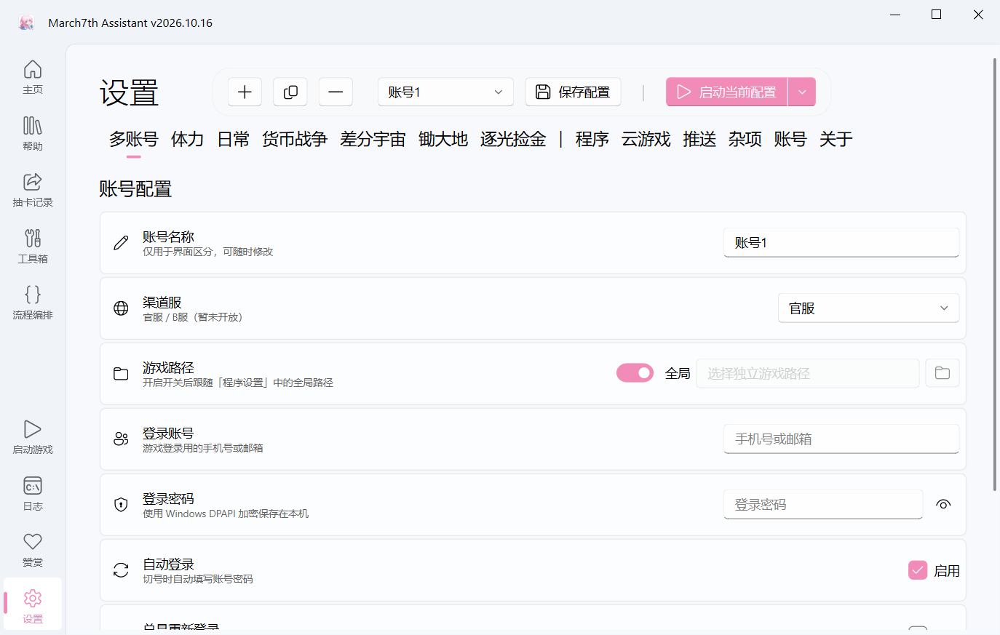

# March7thAssistant-Multi (多账号版)

本项目基于 [March7thAssistant](https://github.com/moesnow/March7thAssistant) 进行二次开发与功能扩展，旨在为其提供**多账号自动化轮询**与**视觉切号**能力。

> ⚠️ **重要提示**：本项目是 `March7thAssistant` 的**非官方衍生分支**，专注于多账号自动化功能。原项目的所有功能与版权归原作者 `moesnow` 所有。本分支并非原项目官方版本，请勿混淆。
>
> **如果你需要原项目的官方版本，请访问**：[moesnow/March7thAssistant](https://github.com/moesnow/March7thAssistant)

在开发多账号配置与切换逻辑时，参考并借鉴了 [StarRailAssistant](https://github.com/Shasnow/StarRailAssistant) 的多账号实现思路。

## ✨ 核心特性

- **多账号独立配置隔离**：每个账号拥有独立的体力、日常、差分宇宙等任务配置，互不干扰。切换账号时，UI 会自动无感刷新。
- **全自动视觉切号（免注册表）**：无需修改 Windows 注册表，通过图像识别 + OCR 模拟真人操作：登出 → 切换账号 → 输入密码 → 进入游戏。
- **智能防串号机制**：结合“总是重新登录”开关，彻底解决“拿错账号打错任务”的问题。
- **悬浮胶囊控制栏**：将账号切换、保存、启动操作整合在顶部的半透明毛玻璃悬浮栏中。
- **一键复制账号配置**：新建小号时，可直接复制大号的任务配置。
- **账号密码 DPAPI 加密**：使用 Windows 底层 DPAPI 技术加密存储，不保留明文。

## 📦 对原项目源码的侵入与修改说明

本项目的设计原则是**极低侵入**。原项目的核心业务逻辑（任务调度、图像识别、OCR、游戏控制等）**未做任何修改**。

我们对原项目源码的修改仅有 **4 处（共 16 行）**，且全部带上了 `# TODO [MULTI_ACCOUNT]` 标记，方便未来同步更新：
1. `main.py`：增加 `multi_account` 任务入口与 `--account` 参数解析。
2. `app/setting_interface.py`：注册多账号 Tab，增加 UI 软刷新接口，添加悬浮顶栏。
3. `app/log_interface.py`：支持带空格的多账号启动参数拆分。
4. `utils/tasks.py`：在任务列表中注册“多账号轮询”。

## 🧩 外置（新增）代码文件说明

多账号的核心功能全部实现在我们新增的独立目录 `core/` 及子页面中，完全与原项目解耦：

- **`core/` 目录**（全新编写）：
  - `account_manager.py`：账号管理核心。负责多账号配置的读取、写入、YAML 隔离、DPAPI 加密。
  - `scheduler.py`：多账号调度器。负责遍历账号列表、任务执行、收尾策略（如静默切号/关机）。
  - `logout.py`：视觉切号状态机。包含所有基于 OpenCV 和 OCR 的“点登出、填密码、防卡死”逻辑。
- **`app/sub_interfaces/multi_account_interface.py`**（全新编写）：多账号配置专属 UI 页面。
- **`settings/multi_account/`**（自动生成）：存放账号列表及每个账号的独立任务 YAML。

## 🖼️ 界面预览



> 💡 **详细的多账号使用教程、排错指南请点击这里：[查看多账号详细文档](./docs/multi_account.md)**

## ⚠️ 注意事项与免责声明

- **服务器适配**：本项目**当前仅适配国服**，B服、国际服等暂不适配，且没有适配计划。
- **使用范围**：本项目**仅供个人学习、参考和使用**。与原项目开源理念保持一致，**不允许任何形式的商业用途、售卖或倒卖行为**。
- **关于更新**：原项目仍在持续更新，本项目会视情况同步，但不保证及时性。由于有代码修改，原项目更新可能导致多账号功能出现兼容性问题，届时需要时间适配。**本项目不包含自动更新功能**，项目更新依然以原 March7thAssistant 为准。

## 🙏 致谢

- 原项目：[moesnow/March7thAssistant](https://github.com/moesnow/March7thAssistant)
- 多账号逻辑参考：[Shasnow/StarRailAssistant](https://github.com/Shasnow/StarRailAssistant)

---

<!-- 下方为原项目自带 README 内容 -->

<div align="center">
  <h1 align="center">
    
    <br/>
    March7thAssistant
  </h1>
  <a href="https://trendshift.io/repositories/3892" target="_blank"></a>
</div>

<br/>

<div align="center">
🌟 点一下右上角的 Star，GitHub 主页就能收到软件更新通知了哦~
</div>

<div align="center">
    
</div>

<br/>

<div align="center">

**简体中文** | [繁體中文](./README_TW.md) | [English](./README_EN.md) | [日本語](./README_JA.md) | [한국어](./README_KR.md)

快速上手，请访问：[使用教程](https://m7a.top/#/assets/docs/Tutorial)

遇到问题，请在提问前查看：[FAQ](https://m7a.top/#/assets/docs/FAQ)

</div>

## 功能简介

- **日常**：清体力、每日实训、领取奖励、委托、锄大地
- **周常**：历战余响、模拟宇宙、差分宇宙、货币战争、混沌回忆、虚构叙事、末日幻影
- **云·星穹铁道**：支持后台运行、无窗口运行和 [Docker](https://m7a.top/#/assets/docs/Docker) 运行
- **抽卡记录导出**：支持 [UIGF](https://uigf.org/zh/standards/uigf.html)/[SRGF](https://uigf.org/zh/standards/srgf.html) 标准
- **工具箱**：自动对话、解锁帧率、兑换码、触屏模式
- 每日实训等任务的完成情况支持**消息推送**
- 任务刷新或体力恢复到指定值后**自动启动**
- 任务完成后**声音提示、自动关闭游戏或关机等**

详情见图形界面设置或 [配置文件](assets/config/config.example.yaml)｜QQ群 [点击跳转](https://qm.qq.com/q/C3IryUWCQw)｜TG群 [点击跳转](https://t.me/+ZgH5zpvFS8o0NGI1)｜哔哩哔哩 [点击跳转](https://space.bilibili.com/3706960664857075)

## 界面展示


## 注意事项

- 遇到错误请在 [Issue](https://github.com/moesnow/March7thAssistant/issues) 反馈，提问讨论可以在 [Discussions](https://github.com/moesnow/March7thAssistant/discussions) ，群聊随缘看
- 欢迎 [PR](https://github.com/moesnow/March7thAssistant/pulls)，提交前请先阅读 [贡献指南](CONTRIBUTING.md)

## 下载安装

前往 [Releases](https://github.com/moesnow/March7thAssistant/releases/latest) 下载后解压双击三月七图标的 `March7th Launcher.exe` 打开图形界面

## 源码运行

如果你是完全不懂的小白，请通过上面的方式下载安装，可以不用往下看了。

需要 Python 3.12 或更高版本。

Windows 下如果通过终端启动，建议使用管理员模式打开 PowerShell、Windows Terminal 或 CMD；Windows 11 24H2 及以上也可以按 [Sudo for Windows](https://learn.microsoft.com/zh-cn/windows/advanced-settings/sudo/) 的方式执行。

```cmd
# 安装（推荐使用虚拟环境）
git clone --recurse-submodules https://github.com/moesnow/March7thAssistant
cd March7thAssistant
pip install -r requirements.txt

# 启动图形界面
python app.py

# 执行完整运行（查看全部子命令：python main.py -h）
python main.py

# 更新
git pull
git submodule update --init --recursive
```

如果使用 `uv`，推荐直接使用项目自带的 `pyproject.toml` 工作流：

```cmd
# 安装（使用 uv）
git clone --recurse-submodules https://github.com/moesnow/March7thAssistant
cd March7thAssistant
uv sync

# 启动图形界面
uv run python app.py

# 查看命令行帮助
uv run python main.py -h

# 执行完整运行
uv run python main.py

# 执行每日实训
uv run python main.py daily
```

<details>
<summary>开发相关</summary>

获取 crop 参数表示的裁剪坐标，可以通过小助手工具箱内「游戏截图」卡片的「捕获」功能

</details>

---

如果喜欢本项目，可以微信赞赏送作者一杯咖啡☕

您的支持就是作者开发和维护项目的动力🚀


---

## 相关项目

March7thAssistant 离不开以下开源项目和运行时依赖的帮助，感谢所有维护者与贡献者：

- 模拟宇宙自动化 [https://github.com/CHNZYX/Auto_Simulated_Universe](https://github.com/CHNZYX/Auto_Simulated_Universe) ：提供模拟宇宙相关能力
- 锄大地自动化 [https://github.com/linruowuyin/Fhoe-Rail](https://github.com/linruowuyin/Fhoe-Rail) ：提供锄大地相关能力
- OCR 文字识别 [https://github.com/RapidAI/RapidOCR](https://github.com/RapidAI/RapidOCR) ：提供游戏内文字识别能力
- 图形界面组件库 [https://github.com/zhiyiYo/PyQt-Fluent-Widgets](https://github.com/zhiyiYo/PyQt-Fluent-Widgets) ：提供主要界面组件与交互体验
- Mirror酱 [https://github.com/MirrorChyan/docs](https://github.com/MirrorChyan/docs) ：提供更新检查与下载分发以及 CDN 加速相关能力
- 图像处理与自动化相关依赖 `OpenCV`、`PyAutoGUI` 等：提供截图采集、图像处理与基础自动化能力
- 推理加速相关依赖 `ONNX Runtime`、`OpenVINO` ：为 OCR 和模型推理提供 CPU / GPU 加速支持

此外，`requirements.txt` 中还包含大量底层依赖，在这里不一一列出；同样感谢这些项目对本项目的支持。


### 🙏 原项目贡献者

以下贡献者列表来自原项目 `moesnow/March7thAssistant`。本多账号分支的代码基于他们的卓越工作构建：

## Contributors
<a href="https://github.com/moesnow/March7thAssistant/graphs/contributors">

  

</a>

## Stargazers over time

<a href="https://star-history.dera.page/#moesnow/March7thAssistant">
 <picture>
   <source media="(prefers-color-scheme: dark)" srcset="https://star-history.dera.page/svg?repos=moesnow/March7thAssistant&theme=dark" />
   <source media="(prefers-color-scheme: light)" srcset="https://star-history.dera.page/svg?repos=moesnow/March7thAssistant" />
   
 </picture>
</a>
